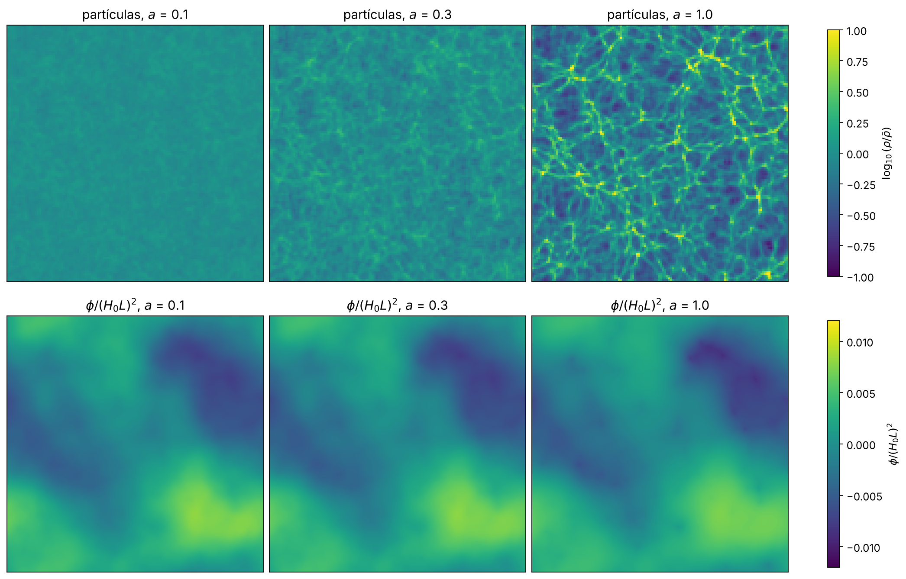
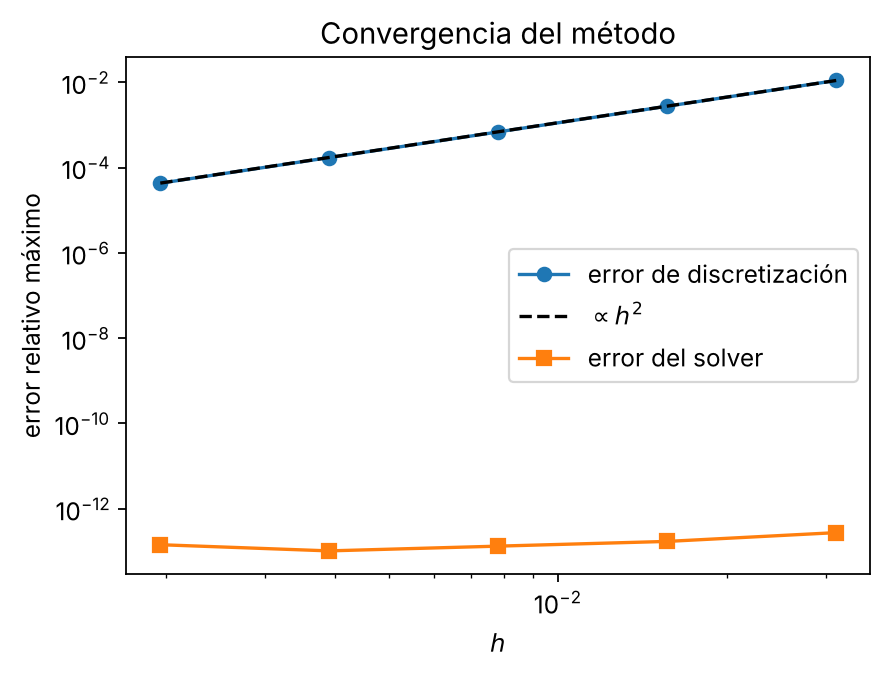
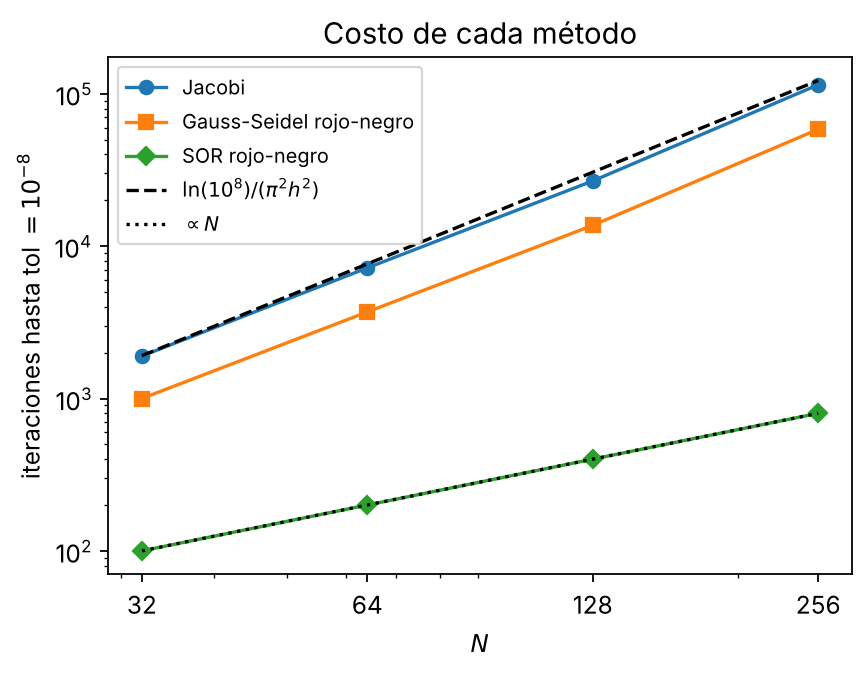
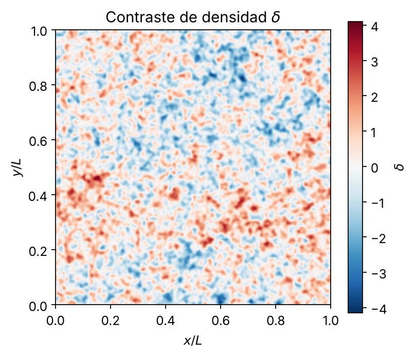
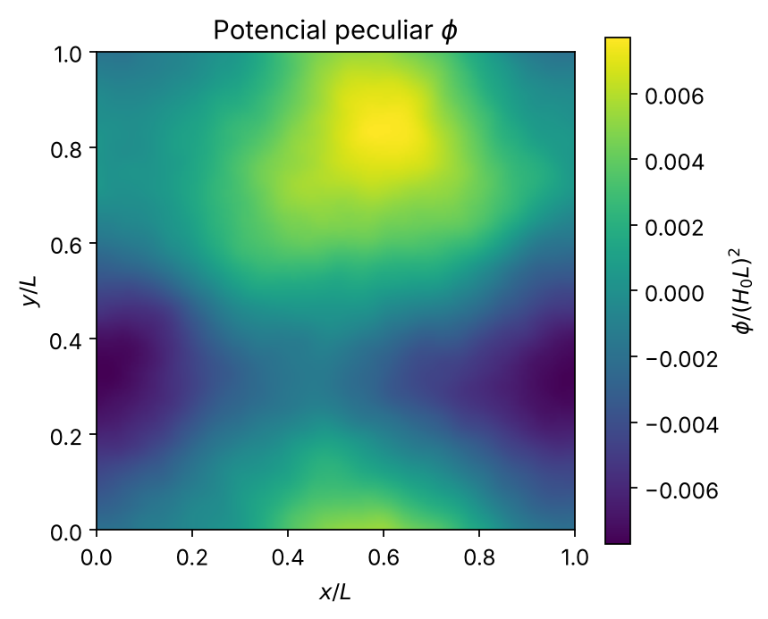
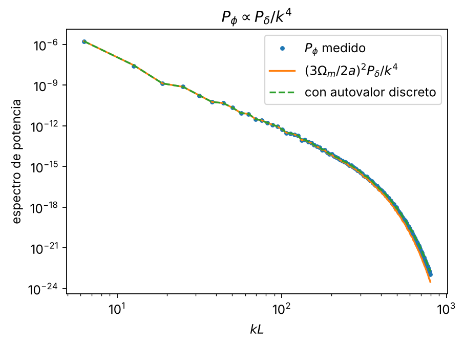
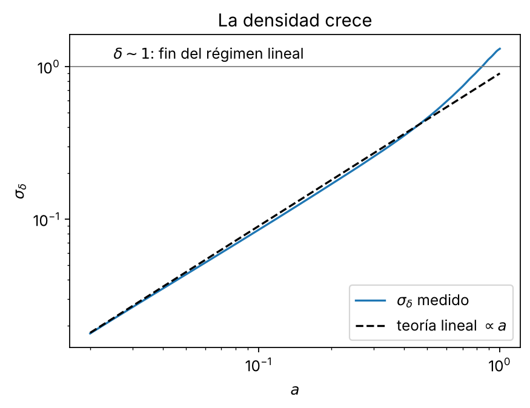
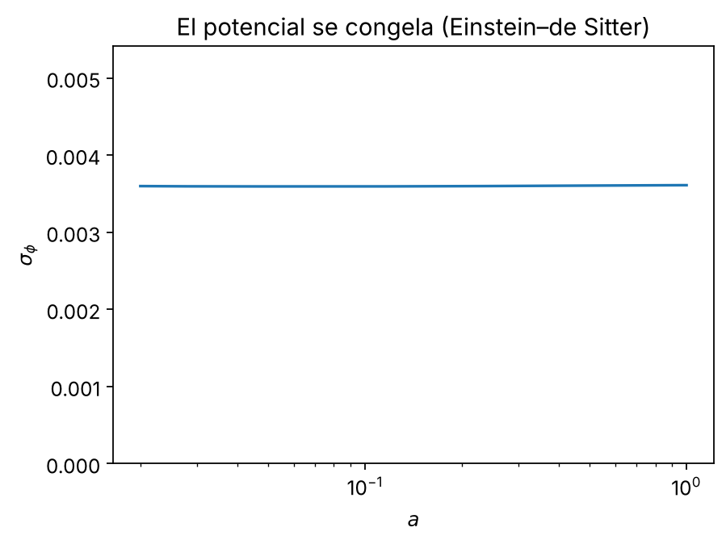

# Ecuación de Poisson comóvil en 2D — Cosmología en GPU

**Proyecto del curso LFIS428 · Programación en GPU y Optimización · Universidad de Valparaíso · 2026**



*Simulación particle-mesh 2D hecha con este proyecto: la gravedad transforma un universo casi uniforme en una red cósmica de filamentos, nodos y vacíos (arriba), mientras el potencial gravitatorio permanece prácticamente constante (abajo).*

---

## 1. Objetivo

Resolver numéricamente la ecuación de Poisson en dos dimensiones,

$$
\nabla^2 u = \frac{\partial^2 u}{\partial x^2} + \frac{\partial^2 u}{\partial y^2} = f(x,y),
$$

y acelerar su solución en GPU con CUDA. A partir del código de referencia `src/poisson_cpu.c`, se discretiza el laplaciano con diferencias finitas y se resuelve el sistema resultante con métodos de relajación:

- Jacobi
- Gauss-Seidel rojo-negro
- SOR rojo-negro

Como aplicación física se usa la **ecuación de Poisson gravitacional en coordenadas comóviles**: el potencial gravitatorio que genera la materia en un universo en expansión.

## 2. Etapas del proyecto

| Etapa | Descripción | Estado |
|---|---|---|
| 1 | Entender el código de CPU: la física, el método numérico y su estructura | ✅ Completa |
| 2 | Portar a CUDA: los datos se quedan en la GPU durante toda la simulación y el resultado se valida contra la CPU | ⏳ En curso |
| 3 | Optimizar: al menos dos optimizaciones, justificadas con mediciones | Pendiente |
| 4 | Analizar el rendimiento: tiempo frente a la CPU en función del tamaño del problema | Pendiente |

## 3. Relevancia

El universo temprano era casi perfectamente homogéneo: las fluctuaciones de densidad que se observan en el fondo cósmico de microondas (CMB) son de una parte en $10^5$. Hoy la materia forma una **red cósmica** de galaxias, cúmulos, filamentos y vacíos. Lo que transformó esas fluctuaciones pequeñas en estructura es la **gravedad**, compitiendo contra la expansión del universo.

Mientras las fluctuaciones son pequeñas se pueden tratar con teoría de perturbaciones. Cuando la densidad local se vuelve comparable al promedio, $\delta \sim 1$, la teoría lineal deja de valer y hay que **simular**. Una simulación cosmológica de N-cuerpos del tipo *particle-mesh* (PM) repite en cada paso de tiempo [2, 4]:

1. Depositar las partículas en una malla para obtener el contraste de densidad $\delta(\mathbf x)$.
2. **Resolver la ecuación de Poisson comóvil** para obtener el potencial $\phi$. Este paso se repite miles de veces por simulación, así que su costo es importante.
3. Calcular la fuerza $-\nabla\phi$ sobre cada partícula.
4. Mover las partículas y avanzar el factor de escala $a(t)$.

Las GPUs son ideales para este problema: la actualización de cada punto de la malla depende solo de sus cuatro vecinos, así que millones de puntos se pueden actualizar en paralelo, un *thread* por punto.

## 4. La física

### 4.1 La expansión como gravedad newtoniana

Consideremos una esfera de radio físico $r = a(t)\,x$ en un universo homogéneo de densidad $\bar\rho(t)$. Aquí $a(t)$ es el factor de escala y $x$ la coordenada **comóvil**, que permanece fija para un observador que solo se deja llevar por la expansión.

Por el teorema de Gauss, la gravedad sobre la superficie de la esfera depende solo de la masa interior, $M = \tfrac{4\pi}{3}\bar\rho\,r^3$:

$$
\ddot r = -\frac{GM}{r^2} = -\frac{4\pi G}{3}\,\bar\rho\,r .
$$

Con $r = a\,x$ y $x$ constante se tiene $\ddot r = \ddot a\,x$. Dividiendo por $a\,x$:

$$
\boxed{\frac{\ddot a}{a} = -\frac{4\pi G}{3}\,\bar\rho}
$$

Esta es la ecuación de aceleración de Friedmann para un universo de materia. La relatividad general da el mismo resultado, más un término de presión [1, 3].

### 4.2 Ecuación de movimiento en coordenadas comóviles

Una partícula de prueba en el potencial gravitatorio total $\Phi$ obedece $\ddot{\mathbf r} = -\nabla_r\Phi$. Se escribe su posición como $\mathbf r = a(t)\,\mathbf x(t)$ y se deriva dos veces:

$$
\dot{\mathbf r} = \dot a\,\mathbf x + a\,\dot{\mathbf x},
\qquad
\ddot{\mathbf r} = \ddot a\,\mathbf x + 2\dot a\,\dot{\mathbf x} + a\,\ddot{\mathbf x}.
$$

Se separa el potencial en la contribución del fondo homogéneo y la de las perturbaciones, $\Phi = \Phi_0 + \phi$. El fondo cumple $\nabla_r^2\Phi_0 = 4\pi G\bar\rho$, cuya solución con simetría esférica es

$$
\Phi_0 = \frac{2\pi G}{3}\,\bar\rho\,r^2
\quad\Rightarrow\quad
-\nabla_r\Phi_0 = -\frac{4\pi G}{3}\,\bar\rho\,\mathbf r = \frac{\ddot a}{a}\,\mathbf r = \ddot a\,\mathbf x ,
$$

donde se usó la ecuación de la sección 4.1. Igualando las dos expresiones para $\ddot{\mathbf r}$:

$$
\ddot a\,\mathbf x + 2\dot a\,\dot{\mathbf x} + a\,\ddot{\mathbf x} = \ddot a\,\mathbf x - \nabla_r\phi ,
$$

los términos $\ddot a\,\mathbf x$ se cancelan (el fondo genera exactamente la expansión), y con $\nabla_r = a^{-1}\nabla_x$ y $H = \dot a/a$ resulta

$$
\boxed{\ddot{\mathbf x} + 2H\dot{\mathbf x} = -\frac{1}{a^2}\nabla_x\phi}
$$

El término $2H\dot{\mathbf x}$ corresponde al arrastre de Hubble: la expansión frena las velocidades peculiares. Esta es la ecuación que integra un código de N-cuerpos cosmológico [2, 4].

### 4.3 La ecuación de Poisson comóvil

El potencial total cumple $\nabla_r^2\Phi = 4\pi G\rho$. Restando la ecuación del fondo se obtiene la ecuación para el potencial peculiar $\phi$:

$$
\nabla_r^2\phi = 4\pi G\,(\rho - \bar\rho) = 4\pi G\,\bar\rho\,\delta,
\qquad
\delta \equiv \frac{\rho - \bar\rho}{\bar\rho},
$$

donde $\delta$ es el **contraste de densidad**. Pasamos a derivadas comóviles con $\nabla_r^2 = a^{-2}\nabla_x^2$:

$$
\nabla_x^2\phi = 4\pi G\,a^2\,\bar\rho\,\delta .
$$

La densidad de materia se diluye con la expansión como $\bar\rho = \bar\rho_0\,a^{-3}$. Usando el parámetro de densidad de materia actual, $\Omega_m = 8\pi G\bar\rho_0/(3H_0^2)$, se obtiene $4\pi G\bar\rho_0 = \tfrac32\,\Omega_m H_0^2$, por lo tanto

$$
\nabla_x^2\phi = \frac32\,\frac{\Omega_m H_0^2}{a}\,\delta .
$$

Medimos las longitudes en unidades del lado $L$ de la caja y el potencial en unidades de $(H_0L)^2$, como en GRAMSES [7]:

$$
\tilde{\mathbf x} = \frac{\mathbf x}{L},
\qquad
\tilde\phi = \frac{\phi}{(H_0L)^2} .
$$

Como $\nabla_x^2 = L^{-2}\nabla_{\tilde x}^2$:

$$
\frac{(H_0L)^2}{L^2}\,\nabla_{\tilde x}^2\tilde\phi = \frac32\,\frac{\Omega_m H_0^2}{a}\,\delta
\quad\Rightarrow\quad
\boxed{\nabla^2\tilde\phi = \frac32\,\frac{\Omega_m}{a}\,\delta}
$$

La ecuación resultante queda sin constantes dimensionales, en una caja de lado 1. Es el $\nabla^2 u = f$ del código de referencia, con $u = \tilde\phi$ y $f = \tfrac32(\Omega_m/a)\,\delta$.

### 4.4 Crecimiento lineal de las perturbaciones

En escalas grandes, la materia oscura fría se comporta como un fluido sin presión. Sus ecuaciones son los dos primeros momentos de la ecuación de Boltzmann sin colisiones (Vlasov), con dispersión de velocidades nula [1, 3]. En coordenadas comóviles, con velocidad peculiar $\mathbf v = a\,\dot{\mathbf x}$:

$$
\dot\delta + \frac1a\nabla\cdot\big[(1+\delta)\,\mathbf v\big] = 0
\qquad\text{(continuidad)},
$$

$$
\dot{\mathbf v} + \frac1a(\mathbf v\cdot\nabla)\mathbf v + H\mathbf v = -\frac1a\nabla\phi
\qquad\text{(Euler)}.
$$

**Linealización.** Mientras $\delta \ll 1$ y $\mathbf v$ es pequeña, los productos $\delta\,\mathbf v$ y $(\mathbf v\cdot\nabla)\mathbf v$ son de segundo orden y se descartan:

$$
\dot\delta + \frac1a\nabla\cdot\mathbf v = 0,
\qquad
\dot{\mathbf v} + H\mathbf v = -\frac1a\nabla\phi .
$$

Derivamos la continuidad en el tiempo, recordando que $\tfrac{d}{dt}\big(a^{-1}\big) = -H/a$:

$$
\ddot\delta = \frac{H}{a}\nabla\cdot\mathbf v - \frac1a\nabla\cdot\dot{\mathbf v} .
$$

La divergencia de Euler da $\nabla\cdot\dot{\mathbf v} = -H\nabla\cdot\mathbf v - \tfrac1a\nabla^2\phi$. Reemplazando:

$$
\ddot\delta = \frac{2H}{a}\nabla\cdot\mathbf v + \frac{1}{a^2}\nabla^2\phi .
$$

Eliminamos $\mathbf v$ con la continuidad, $\nabla\cdot\mathbf v = -a\dot\delta$, y $\phi$ con Poisson, $\nabla^2\phi = 4\pi G\,a^2\bar\rho\,\delta$:

$$
\boxed{\ddot\delta + 2H\dot\delta = 4\pi G\,\bar\rho\,\delta}
$$

Es un oscilador con el signo de la fuerza invertido: la gravedad amplifica la perturbación (una región más densa atrae más materia) y la expansión actúa como fricción.

**Universo de Einstein–de Sitter** (solo materia, $\Omega_m = 1$). Ahí $a \propto t^{2/3}$, de modo que $H = 2/(3t)$ y $4\pi G\bar\rho = \tfrac32 H^2 = 2/(3t^2)$. Probando $\delta \propto t^n$:

$$
n(n-1) + \frac43\,n = \frac23
\quad\Rightarrow\quad
3n^2 + n - 2 = 0
\quad\Rightarrow\quad
n = \frac23
\quad\text{o}\quad
n = -1 .
$$

El modo creciente es $\delta \propto t^{2/3} \propto a$. Reemplazando en la ecuación de Poisson comóvil:

$$
\phi \propto a^2\,\bar\rho\,\delta \propto a^2\cdot a^{-3}\cdot a = \text{constante} .
$$

**La densidad crece, pero el potencial se mantiene constante.**

### 4.5 Observables

El potencial $\phi$ no se mide directamente, pero determina casi todos los observables de los surveys cosmológicos modernos:

- **Clustering de galaxias.** En Fourier, $P_\phi(k) = \left(\tfrac{3\Omega_m H_0^2}{2a}\right)^2 P_\delta(k)/k^4$ [3].
- **Distorsiones en el espacio de redshift.** Las galaxias caen hacia los pozos de potencial, $\mathbf v \propto -\nabla\phi$, lo que permite medir la tasa de crecimiento [13].
- **Lensing gravitacional débil.** El potencial de lente cumple una ecuación de Poisson 2D sobre el cielo, $\nabla_\theta^2\psi = 2\kappa$ [10, 11], medido por ejemplo por Hyper Suprime-Cam [16, 17].
- **Efecto Sachs–Wolfe integrado.** Un potencial que cambia en el tiempo deja una huella en el CMB, $\Delta T/T = \tfrac{2}{c^2}\int\dot\phi\,dt$ [12]; en Einstein–de Sitter se anula, con energía oscura no.

### 4.6 Del problema físico al problema numérico

Una caja cosmológica representa un trozo de un universo homogéneo que se repite, así que usamos **condiciones de borde periódicas** en $[0,1)^2$. La malla tiene $N\times N$ puntos $x_i = i\,h$, con $h = 1/N$, y el laplaciano se aproxima con diferencias finitas de 5 puntos:

$$
(\nabla_h^2 u)_{i,j} = \frac{u_{i+1,j} + u_{i-1,j} + u_{i,j+1} + u_{i,j-1} - 4u_{i,j}}{h^2},
$$

con los índices tomados módulo $N$.

**Condición de compatibilidad.** Al sumar el laplaciano discreto sobre toda la malla periódica, cada $u_{i,j}$ aparece cuatro veces como vecino y $-4$ veces como centro:

$$
\sum_{i,j}(\nabla_h^2u)_{i,j} = 0
\quad\Rightarrow\quad
\sum_{i,j} f_{i,j} = 0 .
$$

La ecuación solo tiene solución si la fuente tiene promedio cero. Es la ley de Gauss: en una caja periódica la "carga" total debe anularse, porque las líneas de campo no tienen por dónde salir. Por eso la fuente es

$$
f = \frac32\,\frac{\Omega_m}{a}\,\big(\delta - \langle\delta\rangle\big):
$$

el promedio de la densidad corresponde al fondo, que ya está contenido en la expansión.

**Modo cero.** Si $u$ es solución, $u + C$ también lo es. El potencial solo importa a través de su gradiente (la fuerza), así que fijamos $\langle u\rangle = 0$.

**Parámetro de sobrerrelajación.** En la caja periódica el modo de error más lento es $(1,0)$, con factor de Jacobi $\rho_J = \cos^2(\pi h)$, de modo que [15]

$$
\omega_{\text{opt}} = \frac{2}{1+\sin(\pi h)\sqrt{1+\cos^2(\pi h)}} .
$$

## 5. Resultados de la Etapa 1

**Convergencia del método.** El error de discretización baja exactamente 4 veces al duplicar $N$ (segundo orden) y el error del solver está en la precisión de máquina.

<p align="center"> </p>

**Costo de cada método.** Jacobi necesita $\sim N^2$ iteraciones, Gauss-Seidel rojo-negro la mitad y SOR solo $\sim N$: con $N = 256$, 114 600 contra 800 iteraciones.

**Un campo cosmológico.** Con una densidad gaussiana aleatoria (izquierda), el potencial (centro) es mucho más suave porque Poisson divide por $k^2$; su espectro sigue $P_\phi \propto P_\delta/k^4$ (derecha).

<p align="center">  </p>

**La simulación particle-mesh.** La densidad sigue el crecimiento lineal $\delta \propto a$ hasta $\sigma_\delta \approx 0.5$ y luego crece más rápido (régimen no lineal); el potencial se mantiene constante, como predice Einstein–de Sitter.

<p align="center"> </p>

## 6. Estructura del repositorio

```
├── README.md
├── src/
│   ├── poisson_cpu.c                 # código de referencia del curso (Dirichlet)
│   └── poisson_comovil_cpu.c         # versión comóvil periódica
├── notebooks/
│   ├── poisson_comovil_LFIS428.ipynb # compila, valida y genera todas las figuras
│   └── proyecto_gpu_cosmology.ipynb  # notas del proyecto (base de este README)
├── figuras/                          # PNG (README) y PDF (informe)
└── informe/
    ├── informe.tex, referencias.bib  # informe con la plantilla de A&A
    ├── informe.pdf
    └── figuras/
```

## 7. Cómo ejecutar

**Código C**

```bash
cd src
gcc -O2 poisson_comovil_cpu.c -lm -o poisson_comovil_cpu.x
./poisson_comovil_cpu.x 256 2 1e-10 0     # N, método (0 Jacobi, 1 GS-RB, 2 SOR-RB), tolerancia, modo (0 test, 1 delta.bin)
```

**Cuaderno.** Abre `notebooks/poisson_comovil_LFIS428.ipynb` en VS Code (con `gcc`, `numpy` y `matplotlib`) o en Google Colab:

```python
!git clone https://github.com/Robboppen/Proyecto-GPU-Poisson-C-movil.git
%cd Proyecto-GPU-Poisson-C-movil/notebooks
```

**Informe.** Sube la carpeta `informe/` a Overleaf o compila con `pdflatex informe && bibtex informe && pdflatex informe && pdflatex informe`.

## Referencias

1. P. J. E. Peebles, *The Large-Scale Structure of the Universe*, Princeton University Press (1980).
2. E. Bertschinger, Simulations of structure formation in the universe, *ARA&A* **36**, 599 (1998). [DOI](https://doi.org/10.1146/annurev.astro.36.1.599)
3. S. Dodelson & F. Schmidt, *Modern Cosmology*, 2.ª ed., Academic Press (2020).
4. R. W. Hockney & J. W. Eastwood, *Computer Simulation Using Particles*, IOP (1988).
5. V. Springel, The cosmological simulation code GADGET-2, *MNRAS* **364**, 1105 (2005). [arXiv:astro-ph/0505010](https://arxiv.org/abs/astro-ph/0505010)
6. R. Teyssier, Cosmological hydrodynamics with adaptive mesh refinement, *A&A* **385**, 337 (2002). [arXiv:astro-ph/0111367](https://arxiv.org/abs/astro-ph/0111367)
7. C. Barrera-Hinojosa & B. Li, GRAMSES: a new route to general relativistic N-body simulations in cosmology. Part I, *JCAP* **01** (2020) 007. [arXiv:1905.08890](https://arxiv.org/abs/1905.08890)
8. C. Barrera-Hinojosa & B. Li, GRAMSES. Part II. Initial conditions, *JCAP* **04** (2020) 056. [arXiv:2001.07968](https://arxiv.org/abs/2001.07968)
9. W. Beordo, M. Bruni, C. Barrera-Hinojosa & M. Crosta, The frame-dragging vector potential on galaxy scales from dark-matter-only Newtonian N-body simulations (2025). [arXiv:2512.08703](https://arxiv.org/abs/2512.08703)
10. M. Bartelmann & P. Schneider, Weak gravitational lensing, *Phys. Rep.* **340**, 291 (2001). [arXiv:astro-ph/9912508](https://arxiv.org/abs/astro-ph/9912508)
11. N. Kaiser & G. Squires, Mapping the dark matter with weak gravitational lensing, *ApJ* **404**, 441 (1993). [DOI](https://doi.org/10.1086/172297)
12. R. K. Sachs & A. M. Wolfe, Perturbations of a cosmological model and angular variations of the microwave background, *ApJ* **147**, 73 (1967). [DOI](https://doi.org/10.1086/148982)
13. N. Kaiser, Clustering in real space and in redshift space, *MNRAS* **227**, 1 (1987). [DOI](https://doi.org/10.1093/mnras/227.1.1)
14. W. L. Briggs, V. E. Henson & S. F. McCormick, *A Multigrid Tutorial*, 2.ª ed., SIAM (2000).
15. W. H. Press et al., *Numerical Recipes*, 3.ª ed., Cambridge University Press (2007), §20.5.
16. H. Aihara et al., Third data release of the Hyper Suprime-Cam Subaru Strategic Program, *PASJ* **74**, 247 (2022). [arXiv:2108.13045](https://arxiv.org/abs/2108.13045)
17. X. Li et al., The three-year shear catalog of the Subaru Hyper Suprime-Cam SSP Survey, *PASJ* **74**, 421 (2022). [arXiv:2107.00136](https://arxiv.org/abs/2107.00136)
18. Ya. B. Zel'dovich, Gravitational instability: an approximate theory for large density perturbations, *A&A* **5**, 84 (1970).
